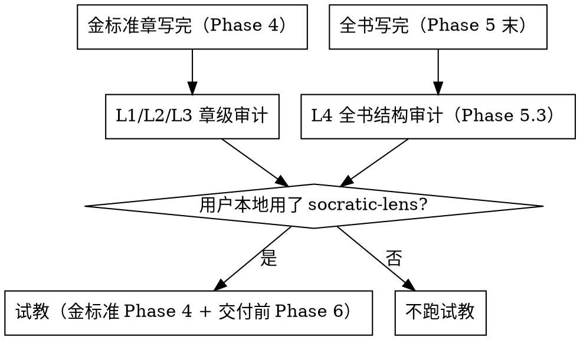

# 审校与教学测试

## 蓝军审校（对抗性审校）

**同一模型不同 prompt 角色的对抗**：写作 agent 以"生成流畅内容"为目标，审计 agent 以"证伪具体主张"为目标。**永远不要让写作 agent 审计自己。**

### 四层审计

| 层 | 检查什么 | 判据 | 何时、对什么对象跑 |
|---|---|---|---|
| **L1 事前规则** | 是否遵守写作规范（按 style-spec 板块语法齐全 / 非对话体 / 禁用词 / 先推导后命名） | 违规条数 | **每个章写完即跑**（Phase 4 金标准、Phase 5 每个并行章各自跑一次） |
| **L2 敏感对齐** | 敏感领域表述是否越界 | 越界 = 整本作废 | **每个章写完即跑**（同 L1，敏感学科尤其），最后全书再扫一遍 |
| **L3 引文抽检** | 随机抽 10 条具名引用，独立回忆判真伪 | phantom（编造）= 该节重写 | **金标准（Phase 4）必跑；Phase 5 每章抽检**；有源场景回源材料索引核对行号 |
| **L4 结构** | 覆盖度、权重、闭环、跨章风格一致性 | STRONG / ADEQUATE / WEAK | **全书写完后跑（并入 Phase 5.3 跨章审计）**——它天然是跨章视角 |

**试教（条件触发）**：教学级实测——拿蓝本喂干净 AI 老师教模拟学生跑 20-30 轮对话。**仅当用户本地使用了 [socratic-lens](https://github.com/xx-hub/socratic-lens) 项目时才做**（金标准定型 Phase 4 + 交付前 Phase 6 各一次）。详见下方"试教"节。

> **一句话记忆**：L1/L2/L3 是**章级**审计，跟着每个章走（写一章审一章，别攒到最后）；L4 是**全书级**结构审计，并入 Phase 5.3；试教是**教学级实测**，仅当用户本地使用了 socratic-lens 时做（金标准和交付前各一次）。所有审计都遵守"独立闭环 + 核实后改"（见 §六）。



## 试教（条件触发）

**试教最能暴露"看起来像样其实教不出去"的蓝本。**

**测什么**：拿蓝本喂给一个上下文干净的"AI 老师"（只给蓝本，不带任何造书推理），让一个"学生"（不预习、有典型误区）与之跑 20-30 轮对话。观察：

- AI 老师能不能用 🎬 场景切入？
- 能不能照 💬 提问路线图引导？
- 学生答偏时能不能用 📌 知识锚定拉回来？
- AI 老师**卡住**吗？**编造**吗？**答非所问**吗？
- 学生**真的抵达知识锚点**了吗？

**何时做——条件触发**：**仅当用户本地使用了 [socratic-lens](https://github.com/xx-hub/socratic-lens) 项目时才做**。用户没在用 socratic-lens → 不跑试教（四层静态审计是必跑底线，试教是可选实测）。金标准定型时（Phase 4）和交付前（Phase 6）各跑一次。

**怎么做**：
- **socratic-lens（主路径）**：把蓝本喂给 [socratic-lens](https://github.com/xx-hub/socratic-lens) 项目，它专门检验"AI 老师是否真能沿主线教学、不跑题、不幻觉"，由用户本地运行。
- **真人测试（可选）**：真人陪跑 20-30 轮对话，最高独立性、最高成本。交付前最终把关、样本蓝本时用。

> ⚠️ **不要在单个 agent 的脑内左右互搏地"写一段师生对话"**——老师和学生共享同一上下文，学生的"误区"是老师脑补出来的，测不出真实盲区，没有独立性价值。必须让"老师"上下文干净。

**金标准节必须扛住试教（若做），才把它塞进后续所有 writing agent 的必读列表。**

## 幻觉 gate（贯穿写作全程）

每个 writing agent 的 prompt 里都要包含这条自我约束：

> **每写一条具名引用/数字/日期前，问自己"我愿意打赌这是真的吗？"——有一丝犹豫就降级为间接转述。**

审计是终检，**写作时的自我 gate 才是主战场**。完整 4 条铁律与执行细节见 §六·6.4。

## 选题前：知识密度 + 深度可达自评（Mode A 尤其重要）

选题前过两道 gate（详见 `source-material.md` §四）：① 密度——AI 就 20 个核心锚点各写一段，有明显犹豫或错误就换题；② 深度可达——对最核心的 3 个概念各写一段"给内行看的 200 字讲解"，用 `references/depth.md` 判定问题评估，三样张都停在"是什么"级 → 建议找源或换领域。古典音乐/教材/哲学/数学效果好；流行文化/版权敏感领域幻觉严重。

## 跨章审计（Phase 5.3）

1. `OUTLINE.md` 跨章关联表 ↔ 各章 🔗 板块一致
2. 单元顺序引用正确（师生合版注意版本差异——如某教材教师用书与学生用书单元顺序相反）
3. 知识递进链没被打断——后一单元依赖的前置概念确实在前面讲过（示例：英语语法链"代词 → 一般现在时 → 名词所有格 → 频度副词 → 一般将来时 → 现在进行时"；数学"分数 → 比例 → 一次方程"；历史"分封制 → 郡县制 → 中央集权"）
4. 追加内容无矛盾（坑型编号 P1/P2/... 不撞车）
5. 深度一致性：各章深度与 style-spec 承诺一致，不能前几章深后几章浅（并行铺章 drift 的常见形态）。

## 六、高级审计纪律：独立闭环与冲突源裁决

### 6.1 独立审计的"上下文干净"原则

审计员应**不知道建造时的推理**——同一个对话 session 里"自审"会不自觉地为自己的选择辩护。正确做法：**审计 agent 从零读取当前产出文件 + 权威源，不看建造日志。** 金标准章、基础设施文件（META/OUTLINE/索引）、附录——每个重要产出物都应过一次独立审计才定型。

**红旗自检**（正在想这些 → STOP）："我自审两遍了，不用再起 subagent" / "我就是最懂这章的人" / "让同事扫一眼就算独立审计了" / "自审通过写进报告，流程就闭环了"。借口真相见 `anti-patterns.md` ③。

> **用会"读完再下结论"的 agent 类型跑审计，不要用偏短探索/搜索的类型。** 后者反复出现在读完若干文件后中途返回一句"我去核对"就结束、不产出完整报告的情况；长篇报告的汇编和审计同理。审计 prompt 里显式要求"完整报告在最终消息里返回、不要中途停"。

### 6.2 "核实后才改"的铁律

审计员也会误判或误读。审计发现问题**多半准**，但修法**要对齐权威源（原文/方案设计）**，不能照单全收。流程：

```
审计报告 → 逐条回权威源核实 → 确认属实 → 改动
                            → 误判 → 保留不动，注明否决原因
```

> **修法的最终依据是权威源/方案设计，不是审计员的建议。**

### 6.3 多源冲突时的裁决规则

当多份源材料对同一概念给出不同说法时：
1. 以**权威层级最高**的源为准（根真相源 > 教学讲义 > 碎片笔记）
2. 站队后在正文加一句注解说明差异，不假装无冲突
3. 同步修订依赖该源的其他索引文件，不一致会引写作 agent 到错误位置

### 6.4 防幻觉铁律（对齐不变量 I2）

以下 4 条取代上方的简短幻觉 gate 备注，写进 META.md / 写作规范，每个 writing agent 必读：

1. **打赌测试**：每写一条具名引用 / 数字 / 定义 / 公式 / 分类名称 / 偏好判断（"PMI 首选 X""应当 Y"）前，问自己"愿不愿打赌这是真的？"有一丝犹豫就回源材料索引核对到源文件+行号，或回已声明的判断根（原则/模型/准则条款）。
2. **追不到源就降级**：核对不到的，降级为间接转述（"通常认为…"）或干脆不写。**绝不杜撰**准则定义、过程编号、公式、偏好断言。
3. **最危险条目逐字回源**：考试/技能/条款类教材的公式、框架名称、分类名称最危险——写前必须回材料逐字核对，凭记忆写大概率出错。
4. **偏好断言必标判断根**（对齐 I2）：当书里有"在 X 情境下首选 Y""应当 Z"这类判断，每条必须标注判断依据出处（回哪条原则/绩效域/准则条款）。标不出依据的偏好断言宁可不写。PMP 的"PMI 会怎么选"板块（why-not+判断依据）是标准做法。

Mode A（无源）替代机制：每个断言必须通过试教（socratic-lens）的学员验证——仅当用户本地使用 socratic-lens 时。

> 审计是终检，**写作时的自我 gate 才是主战场。**

---

## 七、金标准门槛清单（Phase 4 判据）

金标准章必须同时满足以下门槛才"通过"，否则回炉：

### 7.0 金标准章的独立 subagent 审计（先跑这个，再跑下面 6 条）

写完金标准章后，**必须起一个独立 subagent 做结构化审计**——它从零读取约束文件 + 章正文，不带任何造书上下文。审计项：

1. **对照 META.md**：本书定位、防幻觉铁律、读者意识声明、章内板块语法、章末教学区规范、写作纪律、frontmatter schema、AI 老师使用方式、防螺旋铁律、脚手架标题列表——重点核**章内板块语法**与**写作纪律**是否被本章遵守，逐条打钩
2. **对照 OUTLINE.md**：标题匹配、核心问题是否全部回答、该章列出的覆盖目标（考纲任务/课标/知识域等）是否完整兑现、判断根锚定列是否在正文中有显式回扣
3. **对照 源材料索引.md**：预抽关键条目是否全部覆盖（不是一笔带过）、硬记锚有无遗漏、高频陷阱是否被提及
4. **"说清楚了吗"测试**：一个完全没学过该领域的读者，读完能自己说清楚本章标题承诺的三个核心概念吗？哪些被提到但没展开（读者会"这就完了？"）？
5. **贯穿案例一致性**：案例场景是否具体可触摸？概念是否自然从案例事件引出？
6. **自测题质量**：是否全部原创？跨行业覆盖 ≥ 3？每题解析是否说清了"为什么对、为什么错"？
7. **深度四维审计**：对照 style-spec §深度四维承诺，对本章核心概念用 `references/depth.md` 的判定问题逐维核对——该维承诺"中/深"是否兑现？"浅"是否有已确认的理由？判"兑现/未兑现"——「中」= 判定问题能答"是"；「深」= 深列特征完整呈现 + 证据（文件+行号+原文）。每个核心概念至少一个维度真正达到承诺深度（其余承诺维度照常逐维核验），不得全书停在"是什么"级。

审计 subagent 产出结构化报告——每条结论 ✅/⚠️/❌ + 修改建议优先级（P0 必改 / P1 应改 / P2 可改）。

> **为什么必须是独立 subagent**：写金标准的 agent 已经"沉浸"在自己的推导逻辑里，看不出叙事断弧和覆盖缺口。独立审计从零读文件，带着"一个新手读者能不能看懂"的外部视角。

### 7.1-7.6 静态+实测门槛

金标准章必须同时满足以下门槛才"通过"，否则回炉：

1. **板块语法一致**：严格遵守 style-spec 定义的章内板块语法，无遗漏必含板块、无约定外板块
2. **源回溯干净**：随机抽 10 条定义/公式/判断，全部能回源或回判断根（L3 引文抽检）
3. **事实/判断分离**（如选了 fact-vs-judgment 卡）：确定性知识清单里不混入判断类断言
4. **why-not 无附加条件杜撰**（如选了 judgment-card 卡）：候选项排除只靠权威原文明确说过的适用条件
5. **试教通过（条件触发）**：仅当用户本地使用 socratic-lens 时——20-30 轮对话 AI 老师不卡住、不编造、能带学生抵达锚点
6. **深度承诺兑现**：style-spec 声明的四维深度目标达成，未兑现回炉（判据见 §7.0 第 7 项）。

前 4 条 + 第 6 条是静态门槛，第 5 条是实测门槛（条件触发）。

---

## 八、审计后回填约束文件（防复发机制）

> **金标准审计发现的问题，有一半是章的问题（修章），另一半是约束文件的问题（修 META/OUTLINE/索引）。如果不回填约束文件，后面每个并行章都会重踩同一批坑。**

**红旗自检**（正在想这些 → STOP）："修章就够了，回填太慢" / "后面并行章我注意着点就行" / "加一句注释就算回填了"。借口真相见 `anti-patterns.md` ⑥。

### 8.1 回填判断：问题是"章没写对"还是"文件没写清楚"？

审计发现一个 gap 时，先问：

- 这个 gap 是**这个 agent 的疏漏**（别的 agent 大概率不会犯）？→ 只修章
- 这个 gap 是**约束文件没写清楚 / 没要求**（别的 agent 大概率也会犯）？→ **修章 + 修约束文件**

实战判例（学科中立，适用任何领域）：

| 审计发现 | 根因 | 回填哪个文件 |
|---------|------|-------------|
| 正文一句判断根锚定都没有 | 章模板里没有"回扣地基章"的槽位——agent 没被要求写 | **META.md §章内板块语法**：加"回扣地基章"槽位（写法："这就是[地基章讲过的XX原则/定理/框架]在具体情境中的样子"） |
| 开篇场景提出的困境在章末没有回应 | 章模板没有叙事闭环检查——agent 写完开头忘了结尾 | **META.md §章内板块语法**：加"开篇困境必须在某一层推导中被解决/回答"的硬规则 |
| OUTLINE 中该章列出的核心问题有一条没被回答 | OUTLINE 的"核心问题"列被 agent 当参考方向，不是硬约束 | **OUTLINE.md 章骨架表**：在表头前加硬约束——"核心问题列 = 必须回答的问题清单，写完后逐条自检" |
| 某个板块元素全部挤在同一层推导里 | 章模板规定了数量但没说分布规则 | **META.md §章内板块语法**：加"均匀分布在各推导层，不全堆在一层" |
| 源材料索引预抽的关键条目有一条在正文中完全缺失 | 源材料索引有预抽条目，但 agent 没有被要求逐条核对 | **源材料索引.md**：在章条目后附加"写作 agent 覆盖自检清单"，写完后逐条打钩 |

> 上表的本质模式：**审计发现某条规则被违反 → 追问"这条规则写在哪？agent 开工前能看到吗？"→ 如果规则不存在或不够硬 → 把规则补进约束文件。** 学科专属术语（PMBOK7/ECO/Ch3 回扣）替换为你的学科对应物即可。

### 8.2 回填时机和流程

```
金标准章写完 → 独立 subagent 审计（§7.0）
  → 审计报告出来
    → P0/P1 项：逐条修章
    → 同时问：每一条的根因在不在约束文件里？
      → 在 → 同步修 META / OUTLINE / 源材料索引
      → 不在 → 只修章
  → 约束文件修完后，重读一遍确保新规则不自相矛盾
  → 金标准章 + 约束文件双双定稿 → 进入 Phase 5 并行铺章
```

### 8.3 一句话

> **审计不只要修章，还要修"章为什么写错了"。否则每个并行 agent 都会用同样的方式写错。**

---

## 九、sub-agent prompt 模板（单一事实源）

Phase 5 并行铺章与审计的 prompt，用模板文件，不在此重复：

- **REQUIRED** 写作 subagent：用 `references/subagent-prompts/writing-agent-prompt.md` 作 dispatch 模板——金标准章全文、四文件全文、本章源映射、防幻觉铁律 4 条、不变量底线、知识链位置、深度承诺 7 项契约都收在模板里。
- **REQUIRED** 审计 subagent：用 `references/subagent-prompts/audit-agent-prompt.md`——干净上下文、只报告不改文件、严重度分级、完整报告。

主 agent 的 dispatch = 模板 + 本书实际值填入 `{{占位符}}`。模板缺项 = 该 agent 开工前看不到关键约束。

---

## 十、三阶段递进审计（成书流程）

一本书从"写完"到"定稿"，要过**三轮**审计，一轮都不能省：

### 第一轮：章级独立审计（跟着写作走）

每写完一章（或每写完一批 2-4 章），起一个**上下文干净的独立 subagent** 审这一章。这一轮对应上面的 L1-L3，重点是**章内问题**：板块齐全、Voice、近逐字版权、预抽条目覆盖、练习/自测题质量。

> ⚠️ **写作 agent 的自审不算审计。** 写作者已经"沉浸"在自己的推导里，会对"这句话其实是源材料的原句""这段我以为讲透了其实跳步了"失明。实战中反复出现：写作 agent 完工时自报"定义都从案例推导、无逐段翻译、版权安全"，独立审计却在同一章查出多处近逐字照搬源材料（含把源文件的图表重制）。**永远另起一个没参与写作的 agent 审。**

### 第二轮：全书结构与索引审计（全书写完后）

所有章 + 附录写完后，起独立审计员做**跨章/全书级**检查（对应 L4）。重点不是单章文采，而是"拼起来对不对"：

- **外部清单与章节的映射表**（考纲/课标/ECO/知识点清单 ↔ 章）——逐条回权威源核对名称、编号、归属章。这类"索引/映射表"是错误高发区：条目整条错位、归属章标反、声称某章覆盖实则查无实据。
- 跨章事实一致性（贯穿案例的数字、人名、设定、计数）
- 时间线与因果顺序（前章说先发生 X，后章不能说先发生 Y）
- 术语统一（同一概念在不同章不能有两个译名/说法）
- 交叉引用不悬空（"见第 X 章"那章真的讲了；附录里的"见卡 X.Y"真的存在）
- 目录/标题与正文一致（复制粘贴残留最容易藏在这里）

> 这一轮的典型现象：**正文本身没硬伤，问题全在"索引/目录/映射表"上**——它们是收尾疲劳期最容易被草率处理、又最先被读者看到的东西。任何"全书-章节-知识点"的对应表，都必须以权威源为唯一真相源逐条重核，不能凭作者记忆。

### 第三轮：修订复审（修完第二轮之后）

第二轮报的问题修完后，**必须再过一遍审计**，目标是两件事：

1. **核实修复真的到位**：声称修了的，逐条回原文确认改对了、改全了（实战中出现过"声称统一了术语，但全书 grep 还有残留"）。
2. **查修订引入的新问题**：改 A 处时容易漏掉 B 处的连锁更新。典型情形——
   - 改了一章里的一个数字/结论，忘了改同章它的图表、正文复述、章末总结、对全书的汇报；
   - 统一了术语，正文改了附录没改；
   - 修了源文件，但合并产物（BOOK.md/导出文件）是旧的，没重跑生成。

这一轮优先用**程序化扫描**处理机器擅长的：叠字/残句、标记配平、表格列数、TODO/占位符、练习题答案与选项映射、内部链接有效性——人在这些上面不如 grep。

### 执行要点（通用，与学科无关）

- **审计用能产出完整报告的 agent 类型**：不要用只做短探索/搜索的 agent 类型跑审计——它们倾向于读几个文件就中途返回、不产出结论。用会"读完再下判断、把完整报告作为最终输出"的类型。prompt 里显式要求"完整报告在最后一条消息里返回、不要中途停"。
- 审计 prompt 必须明确：**只报告、不改文件**；每条结论给证据（文件+行号+原文）；按严重度分级（P0 必改 / P1 应改 / P2 可改）；要求诚实、具体。
- 审计员也会误判（§6.2）——主 agent 要把审计结论**逐条回权威源核实**再改，不照单全收。审计能查出真问题，也会把正确的东西当问题报；核实这一步不能省。

### 一句话

> **章级审计查"这章写对没有"，全书审计查"这本书拼对没有"，复审查"改完之后还是不是对的"。** 三轮缺一不可——第一轮漏掉的章内错误会进全书，第二轮漏掉的索引/一致性错误会进定稿，第三轮漏掉的连锁错误是修出来的新 bug。
